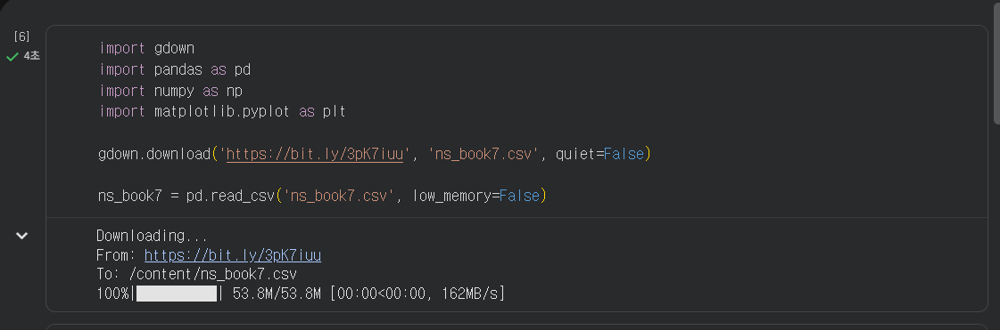
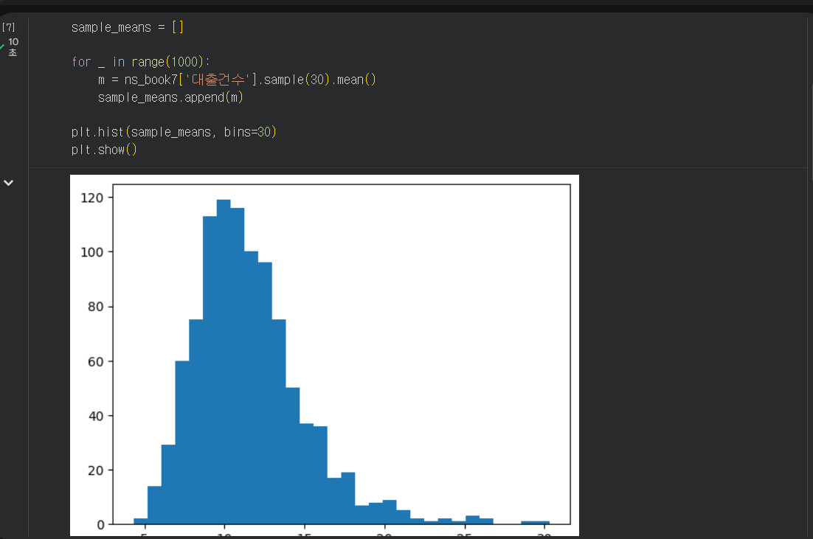
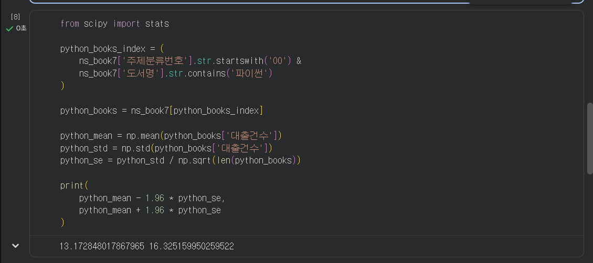
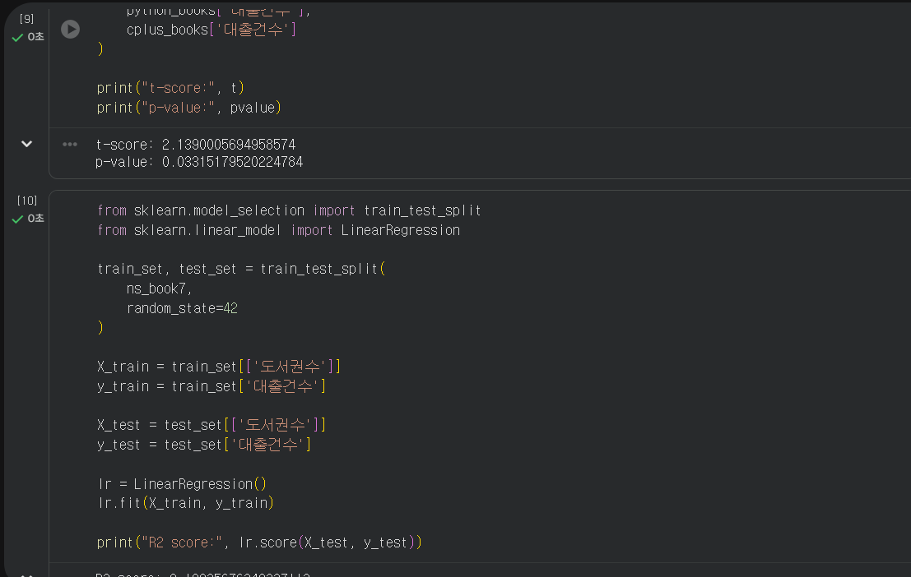

# 데이터분석 7주차 정규과제

📌데이터분석 정규과제는 매주 정해진 분량의 『*혼자 공부하는 데이터 분석 with 파이썬*』 을 읽고 학습하는 것입니다. 이번 주는 아래의 **DataAnalysis_7th_TIL**에 나열된 분량을 읽고 공부하시면 됩니다.

아래의 문제를 풀어보며 학습 내용을 점검하세요. 문제를 해결하는 과정에서 개념을 스스로 정리하고, 필요한 경우 제시된 강의를 참고하여 보완하는 것이 좋습니다.

<!-- 강의 링크는 아래와 같습니다.
https://www.youtube.com/watch?v=R3E4m8fqUSg&list=PLVsNizTWUw7FGzSRCkQrPEEe-ljVXgS7k&index=14
https://www.youtube.com/watch?v=W_cxRstQUk8&list=PLVsNizTWUw7FGzSRCkQrPEEe-ljVXgS7k&index=15
-->


## DataAnalysis_7th_TIL

### 7장 검증하고 예측하기
#### 01. 통계적으로 추론하기
#### 02. 머신러닝으로 예측하기


## Study Schedule

| 주차  | 공부 범위     | 완료 여부 |
| ----- | ------------- | --------- |
| 1주차 | p.24~81    | ✅         |
| 2주차 | p.84~151   | ✅         |
| 3주차 | p.154~219  | ✅         |
| 4주차 | p.222~279 | ✅         |
| 5주차 | p.282~325 | ✅         |
| 6주차 | p.328~379 | ✅         |
| 7주차 | p.382~430 | ✅         |

<br>

<!-- 여기까진 그대로 둬 주세요-->


# 1️⃣ 개념 정리 

## 01. 통계적으로 추론하기

- 모집단은 관심 대상이 되는 전체 데이터이고, 표본은 모집단에서 일부를 추출한 데이터이다.
- 모수검정은 표본을 이용해 모집단의 평균이나 분산과 같은 파라미터를 추정하거나 가설을 검정하는 방법이다.
- 표준점수(z 점수)는 데이터가 평균에서 표준편차의 몇 배만큼 떨어져 있는지를 나타내는 값이다.
- 표준정규분포는 평균이 0이고 표준편차가 1인 정규분포이다.
- `scipy.stats.zscore()`를 이용하면 데이터의 z 점수를 계산할 수 있다.
- `norm.cdf()`는 특정 z 점수까지의 누적분포 비율을 계산하고, `norm.ppf()`는 특정 누적분포 비율에 해당하는 z 점수를 구한다.
- 중심극한정리는 동일한 모집단에서 충분히 큰 표본을 반복해서 추출하면 표본평균의 분포가 정규분포에 가까워진다는 개념이다.
- 일반적으로 표본의 크기가 30 이상일 때 중심극한정리를 적용하기 좋은 기준으로 본다.
- 신뢰구간은 표본의 통계량을 이용하여 알려지지 않은 모집단의 파라미터가 포함될 것으로 추정하는 범위이다.
- 가설검정에서는 두 집단 사이에 통계적인 차이가 없다고 보는 가설을 귀무가설, 차이가 있다고 보는 가설을 대립가설이라고 한다.
- 일반적으로 p-value가 0.05보다 작으면 귀무가설을 기각한다.
- 순열검정은 모집단이 정규분포를 따른다는 가정 없이 두 표본의 데이터를 무작위로 섞어 통계량을 반복적으로 비교하는 비모수 검정 방법이다.


## 02. 머신러닝으로 예측하기

- 머신러닝은 데이터에서 패턴이나 규칙을 학습하고 새로운 데이터에 대해 예측을 수행하는 방법이다.
- 지도 학습은 입력 데이터와 정답에 해당하는 타깃이 함께 있는 데이터를 이용하여 모델을 학습한다.
- 비지도 학습은 입력 데이터는 있지만 타깃이 없는 데이터에서 의미 있는 패턴을 찾는 방법이다.
- 모델을 공정하게 평가하기 위해 전체 데이터를 훈련 세트와 테스트 세트로 나누어 사용한다.
- 훈련 세트는 모델을 학습하는 데 사용하고, 테스트 세트는 학습된 모델의 성능을 평가하는 데 사용한다.
- `train_test_split()`을 사용하면 데이터를 무작위로 훈련 세트와 테스트 세트로 나눌 수 있다.
- 선형 회귀는 연속적인 값을 예측하는 대표적인 지도 학습 회귀 알고리즘이다.
- 사이킷런의 `LinearRegression` 클래스로 선형 회귀 모델을 만들 수 있다.
- `fit()` 메서드로 모델을 학습하고 `score()` 메서드로 모델의 성능을 평가할 수 있다.
- 선형 회귀 모델의 `score()` 메서드는 결정계수를 반환하며, 일반적으로 1에 가까울수록 예측 성능이 좋다.
- 로지스틱 회귀는 이름에 회귀가 포함되어 있지만 분류 문제에 사용하는 알고리즘이다.
- 이진 분류에서는 일반적으로 0을 음성 클래스, 1을 양성 클래스로 표현한다.
- 분류 모델의 `score()` 메서드는 정확도를 반환한다.
- 클래스 비율이 불균형한 데이터에서는 정확도만으로 모델의 성능을 판단하면 잘못 해석할 수 있다.
- `DummyClassifier`는 가장 많은 클래스를 기준으로 예측하여 분류 모델 성능의 기준점을 제공한다.


# 2️⃣ 수행 인증











<br>
<br>

# 3️⃣ 확인 문제

## 문제 1.

> **🧚Q. 어떤 표본의 크기가 충분히 크고(n ≥ 30), 모집단 분산을 알 수 없을 때 모평균에 대한 신뢰구간을 구하려고 한다.
이때 다음 설명 중 가장 적절한 것은 무엇인가?**

```
1️⃣ 표본의 크기가 충분히 크므로 중심극한정리에 의해 표본평균의 분포는 근사적으로 정규분포를 따른다.  
2️⃣ 모집단 분산을 모르므로 신뢰구간을 구할 수 없다.  
3️⃣ 표본이 30개 이상이면 항상 모집단도 정규분포를 따른다.  
4️⃣ 중심극한정리는 모집단이 정규분포일 때만 적용된다.
```

```
정답: 1️⃣

표본의 크기가 충분히 크면 중심극한정리에 의해 표본평균의 분포가 근사적으로 정규분포를 따르므로 모집단 평균에 대한 추론이 가능하다.
```


## 문제 2.

> **🧚Q. 다음 중 순열검정(permutation test)에 대한 설명으로 가장 옳은 것은 무엇인가?**

```
1️⃣ 모집단이 정규분포를 따른다는 가정을 반드시 해야 한다.  
2️⃣ 표준점수(z-score)를 이용하여 유의확률을 계산하는 방법이다.  
3️⃣ 데이터의 라벨을 무작위로 섞어 귀무가설 하에서의 분포를 직접 구성하는 비모수적 검정 방법이다.  
4️⃣ 표본의 크기가 충분히 클 때만 사용할 수 있다.
```

```
정답: 3️⃣

순열검정은 두 표본의 데이터를 무작위로 섞고 다시 나누는 과정을 반복하여 귀무가설 하에서의 통계량 분포를 직접 구성하는 비모수적 검정 방법이다.
```


### 🎉 수고하셨습니다.